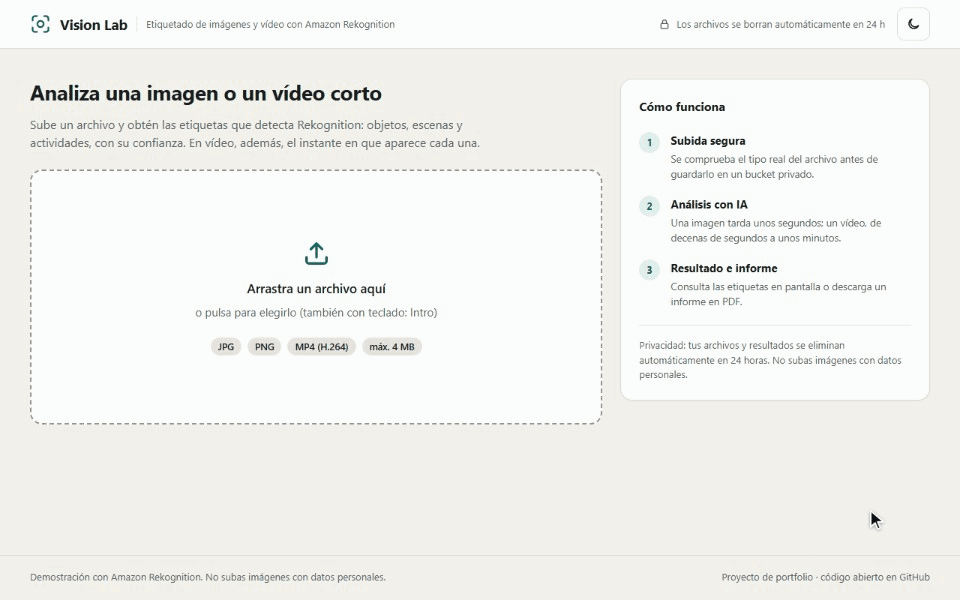
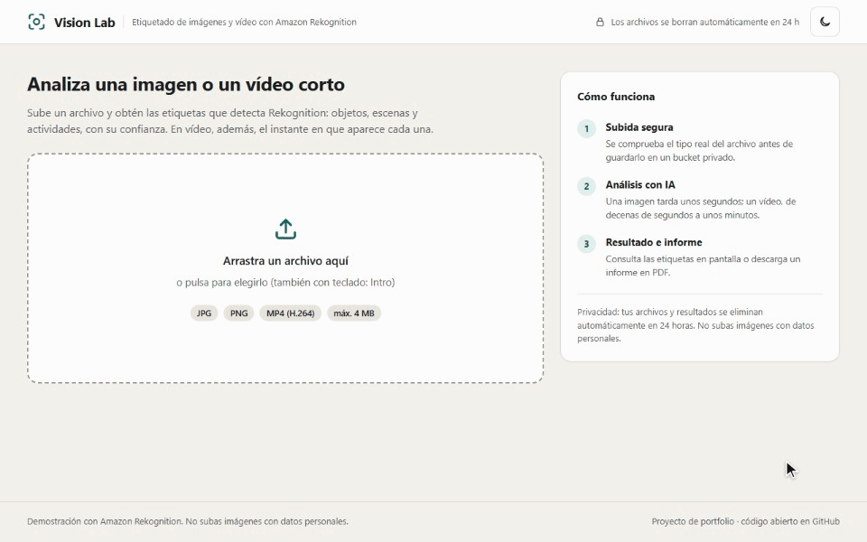
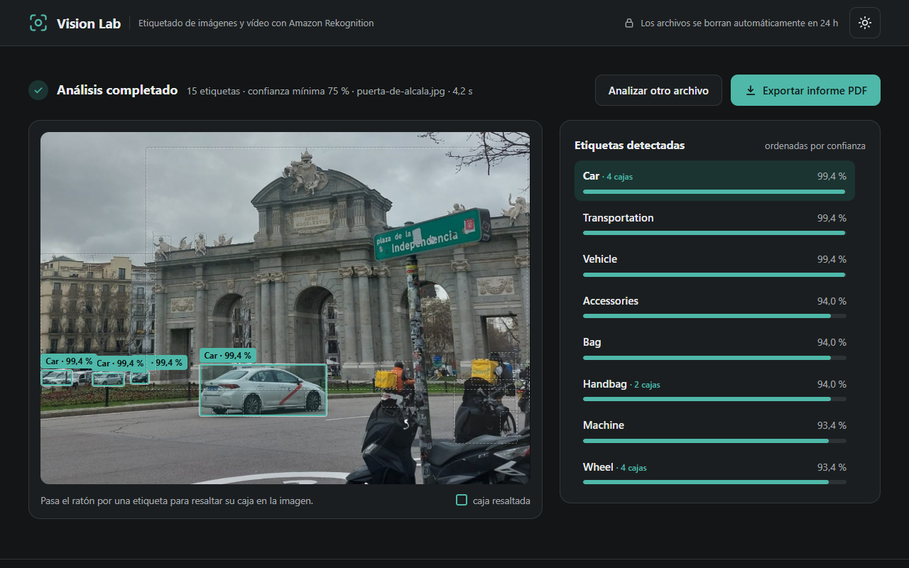

# aws-rekognition-serverless — Vision Lab

Aplicación web que analiza **imágenes y vídeos cortos con Amazon Rekognition** sobre una arquitectura **serverless y orientada a eventos** en AWS. El usuario sube un archivo y recibe las etiquetas detectadas (objetos, escenas, actividades) con su confianza; en imagen, las cajas de cada objeto; en vídeo, el instante en que aparece cada etiqueta.

Se usan los modelos ya entrenados de Rekognition: **no se entrena ningún modelo**. Todo se despliega con **Terraform** y **GitHub Actions** (OIDC, sin claves estáticas).

> "Vision Lab" es el nombre de la "empresa". Se cambia en un único sitio (variable `app_name` de Terraform, que llega al frontend vía `config.js`).

**Servicios:** API Gateway (HTTP API) · Lambda (Python 3.12) · S3 · SNS · Rekognition · IAM · CloudFront · CloudWatch Logs.

## Demo

Grabada sobre un despliegue real en AWS (ya destruido). Etiquetas, cajas y tiempos son los que devolvió Rekognition.

**Imagen:** se arrastra la foto, se analiza en unos segundos y, al pasar el puntero por una etiqueta, se resaltan sus cajas.



**Vídeo:** el análisis es asíncrono (Rekognition Video + SNS) y la espera en cola se ha recortado en la grabación. Pulsar una etiqueta lleva el vídeo a su primera aparición; la barra muestra el intervalo en que se detecta.



<details>
<summary>Modo oscuro</summary>



</details>

> Rekognition no es infalible: en el vídeo de cerdos también detectó "Weapon" o "Kangaroo". Se muestran tal cual, con su confianza.

---

## Índice

1. [Arquitectura](#arquitectura)
2. [Contrato de la API y de los resultados](#contrato-de-la-api-y-de-los-resultados)
3. [Seguridad](#seguridad)
4. [Frontend](#frontend)
5. [Estructura del repositorio](#estructura-del-repositorio)
6. [Despliegue](#despliegue)
7. [Variables y salidas](#variables-y-salidas)
8. [Límites conocidos](#límites-conocidos)
9. [Coste](#coste)
10. [Decisiones de diseño](#decisiones-de-diseño)
11. [Origen del proyecto](#origen-del-proyecto)

---

## Arquitectura

```
Usuario ──► CloudFront (https://<id>.cloudfront.net)
              ├─ /                 → bucket FRONTEND (privado, OAC)
              ├─ /output/*         → bucket DATOS   (privado, OAC)
              └─ /output-video/*   → bucket DATOS   (privado, OAC)

Frontend ── POST /upload ──► API Gateway (HTTP API) ──► Lambda Upload ──► S3 datos: input/
                                                        (CORS limitado al dominio de CloudFront)

S3 datos: input/ ──(evento ObjectCreated, prefijo input/)──► Lambda Process
   ├─ imagen → Rekognition DetectLabels ──────────────────► S3 datos: output/<id>.json
   └─ vídeo  → Rekognition StartLabelDetection (asíncrono)
                  └─ al terminar: SNS ──► Lambda Video Result ──► S3 datos: output-video/<id>.json

Frontend: consulta periódicamente /output/<id>.json o /output-video/<id>.json
```

**Flujo**

1. El navegador carga la web desde CloudFront. Los dos buckets son privados; CloudFront los lee con **Origin Access Control (OAC)**.
2. El archivo se envía en binario a `POST /upload`. **Upload** valida tamaño y tipo **por la firma del archivo** (no por el `Content-Type`) y lo guarda en `input/upload-<uuid>.<ext>`.
3. El evento `ObjectCreated` de S3 (solo prefijo `input/`) activa **Process**:
   - **Imagen** → `DetectLabels` (síncrono) → `output/<id>.json`.
   - **Vídeo** → `StartLabelDetection` (asíncrono, idempotente con `ClientRequestToken`). Process no espera.
4. Cuando Rekognition termina el vídeo publica en **SNS**, que activa **Video Result**: pagina todos los resultados, los agrega por etiqueta y escribe `output-video/<id>.json`.
5. El frontend consulta el resultado por CloudFront con **polling con retroceso** (1 s → 4 s) hasta que existe o se agota el tiempo.

**Por qué no hay bucles:** la notificación de S3 solo se dispara para `input/`, y las Lambdas escriben en `output/` y `output-video/`. Process además comprueba el prefijo en el código (defensa en profundidad).

**Por qué CORS:** el navegador llama al API (`*.execute-api.*`) desde el dominio de CloudFront, que es otro origen. El CORS del API se limita a ese dominio.

---

## Contrato de la API y de los resultados

El frontend no interpreta mensajes de texto: todo es JSON con un campo de estado o de error explícito.

### `POST /upload`

- **Cuerpo:** el archivo en binario. El `Content-Type` es informativo; el servidor no se fía de él.
- **Tipos aceptados (por firma):** JPEG (`FF D8 FF`), PNG (`89 50 4E 47 0D 0A 1A 0A`), MP4 (`ftyp` en los bytes 4–8). Un JPEG con extensión `.png` se acepta como JPEG.
- **Tamaño máximo:** `max_upload_bytes` (4 MiB por defecto).

| Código | Cuerpo |
|---|---|
| 200 | `{ "id": "<uuid>", "kind": "image" \| "video" }` |
| 400 | `{ "error": "empty_body" \| "file_too_large" \| "unsupported_type" }` |
| 500 | `{ "error": "internal_error" }` — el detalle solo va a los logs |

### Resultado de imagen — `GET /output/<id>.json`

```json
{
  "status": "SUCCEEDED",
  "kind": "image",
  "labels": [
    { "name": "Dog", "confidence": 99.3,
      "instances": [ { "boundingBox": { "left": 0.1, "top": 0.2, "width": 0.5, "height": 0.6 } } ] }
  ]
}
```

Las coordenadas de `boundingBox` son proporciones (0–1) del ancho y alto de la imagen. `instances` puede estar vacío (etiquetas de escena como "Outdoors").

### Resultado de vídeo — `GET /output-video/<id>.json`

```json
{
  "status": "SUCCEEDED",
  "kind": "video",
  "durationMs": 20700,
  "labels": [
    { "name": "Beach", "confidence": 98.1, "firstSeenMs": 0, "lastSeenMs": 20000, "occurrences": 21 }
  ]
}
```

Agregado por nombre de etiqueta: confianza máxima, primera y última aparición y número de detecciones. Ordenado por `firstSeenMs`.

### Fallo (imagen o vídeo)

```json
{ "status": "FAILED", "kind": "image", "error": "processing_failed" }
```

| `error` | Significado |
|---|---|
| `processing_failed` | Error no recuperable al leer o analizar el archivo |
| `unsupported_video_codec` | El vídeo no es H.264 (Rekognition Video solo admite H.264 en MP4/MOV) |
| `analysis_failed` | Rekognition terminó el trabajo de vídeo con un estado distinto de `SUCCEEDED` |

Todos los resultados se escriben con `Content-Type: application/json` y `Cache-Control: no-store`. Mientras el resultado no existe, CloudFront devuelve 403 (S3 sin `s3:ListBucket`); el frontend trata cualquier respuesta no OK como "aún no está listo".

---

## Seguridad

| Riesgo | Control |
|---|---|
| Lectura de archivos subidos | `input/` nunca se expone; buckets privados con bloqueo total; expiración a 1 día |
| Abuso de coste del endpoint público | Throttling en API Gateway, concurrencia limitable, tope de 4 MiB, validación por firma |
| Escalada por credenciales amplias | Un rol por función, sin políticas `*FullAccess`, `iam:PassRole` condicionado al servicio |
| Suplantación de Rekognition/S3 (*confused deputy*) | `source_account` / `aws:SourceArn` en confianzas y permisos de invocación |
| XSS / inyección en el frontend | CSP estricta, sin CDN, `textContent`, sin estilos en línea |
| Fuga de secretos o endpoints | `config.js` generado por Terraform y no versionado; la app no tiene secretos |
| Reintentos que duplican coste | `ClientRequestToken` en Rekognition Video |
| Tráfico sin cifrar hacia S3 | Políticas de bucket que deniegan `aws:SecureTransport = false` |

IAM por función:

| Rol | Permisos |
|---|---|
| `upload` | logs propios; `s3:PutObject` en `data/input/*` |
| `process` | logs propios; `s3:GetObject` en `input/*`; `s3:PutObject` en `output/*` y `output-video/*`; `rekognition:DetectLabels`, `rekognition:StartLabelDetection`; `iam:PassRole` solo sobre el rol de Rekognition |
| `video-result` | logs propios; `rekognition:GetLabelDetection`; `s3:PutObject` en `output-video/*` |
| `rekognition-sns` | `sns:Publish` en el topic de finalización |

Las acciones de Rekognition usadas no admiten permisos a nivel de recurso, por eso llevan `Resource: "*"`.

---

## Frontend

HTML + CSS + JavaScript (módulos ES), sin framework, sin bundler y sin dependencias en tiempo de ejecución salvo **jsPDF 4.2.1 autoalojado** en `frontend/vendor/jspdf/` (versión, hashes y licencia en su [README](frontend/vendor/jspdf/README.md)), que se carga solo al exportar el informe. Tipografía del sistema y ningún recurso externo, de modo que funciona con la CSP estricta de CloudFront.

| Estado | Qué se ve |
|---|---|
| Reposo | Zona de arrastre (también con teclado), formatos admitidos, "Cómo funciona" y aviso de privacidad |
| Subiendo / analizando | Vista previa local del archivo, progreso de subida, tiempo transcurrido y botón **Cancelar** |
| Resultado de imagen | Cajas superpuestas; pasar el ratón (o el foco) por una etiqueta resalta sus cajas y pulsarla la fija |
| Resultado de vídeo | Reproductor nativo, línea de tiempo e intervalo de cada etiqueta; pulsar una etiqueta salta a su `firstSeenMs` |
| Error | Motivo claro (p. ej. vídeo que no es H.264, con el comando para convertirlo) y opción de analizar otro archivo |

- **Polling** con retroceso de 1 s a 4 s; espera de 60 s (imagen) y 15 min (vídeo) desde `config.js`. Cualquier respuesta no OK o error de red cuenta como "aún no". Si se agota, el análisis no se da por fallido: la interfaz indica que sigue en curso y ofrece **Seguir esperando**, que vuelve a consultar el mismo resultado.
- **Validación en cliente** por firma del archivo y tamaño, con la misma regla que la Lambda (el servidor sigue siendo la autoridad). Sin compresión ni WebM.
- **Informe PDF**: nombre del archivo, fecha, parámetros, vista previa con cajas (imagen) y tabla de etiquetas.
- **Accesibilidad**: zona de arrastre operable con teclado, región `aria-live` para los cambios de estado, foco gestionado al cambiar de vista, foco visible, contraste AA, `prefers-reduced-motion` y tema claro/oscuro (`prefers-color-scheme` + conmutador).
- **Seguridad**: etiquetas insertadas con `textContent`, sin atributos `style` en el HTML (estilos dinámicos con CSSOM), sin `innerHTML` ni `eval`, sin `console.log` de datos (modo `DEBUG` desactivado por defecto).

Las capturas de referencia del diseño están en [`docs/design/`](docs/design/).

---

## Estructura del repositorio

```
aws-rekognition-serverless/
├── README.md
├── GUIA-manual-referencia.md      # montaje manual (consola + CLI), material educativo
├── infrastructure/
│   ├── README.md
│   ├── bootstrap/                 # bucket de estado + proveedor OIDC de GitHub + rol de despliegue
│   ├── environments/prod/         # conexión de módulos, backend, config.js.tftpl
│   └── modules/
│       ├── storage/               # buckets data + frontend, políticas, ciclo de vida
│       ├── lambda-function/       # rol, políticas, log group, función y empaquetado
│       ├── rekognition-sns/       # topic, rol de Rekognition, suscripción
│       ├── api-gateway/
│       └── cloudfront/
├── backend/                       # upload/, process/, video_result/ (handler.py)
├── tests/                         # pytest: lógica pura y handlers con dobles de AWS
├── requirements-dev.txt           # boto3 + pytest, solo para tests
├── pytest.ini
├── frontend/                      # HTML + CSS + JS (módulos ES), sin dependencias salvo jsPDF autoalojado
├── samples/                       # archivos de prueba propios o CC0
├── docs/design/                   # maqueta de referencia del diseño
├── docs/demo/                     # GIF de la demo y captura en modo oscuro
├── .github/
│   ├── workflows/                 # ci.yml (PR) y deploy.yml (main)
│   └── dependabot.yml             # actualizaciones mensuales de acciones, providers y pip
└── LICENSE
```

Las Lambdas solo dependen de `boto3` (incluido en el runtime), así que no hay capas ni pasos de build: Terraform empaqueta cada `handler.py` con `archive_file`.

Cada `handler.py` separa la **lógica pura** (detección de tipo por firma, parseo de claves, normalización de DetectLabels, agregación de etiquetas de vídeo, clasificación de errores) de las llamadas a AWS, que se hacen con clientes creados bajo demanda. Así los tests cargan los handlers y sustituyen los clientes por dobles en memoria, sin credenciales ni red.

### Tests

```bash
python -m venv .venv
.venv/bin/pip install -r requirements-dev.txt      # Windows: .venv\Scripts\pip
.venv/bin/python -m pytest
```

---

## Despliegue

El método de despliegue es **Terraform + GitHub Actions**. La [guía manual](GUIA-manual-referencia.md) explica cómo montar lo mismo a mano, pero solo como material de aprendizaje.

> Usa una **cuenta de AWS de pruebas**. El rol de despliegue tiene permisos amplios (crea roles de IAM) y Rekognition factura por uso.

### Requisitos

- Terraform ≥ 1.10 (bloqueo nativo de estado en S3, `use_lockfile`); el CI usa la 1.17.1.
- AWS CLI v2 con una sesión de usuario (IAM Identity Center o usuario con MFA). No hacen falta claves de acceso de larga duración.
- Python 3.12 y `pytest` para los tests (opcional en local; el CI los ejecuta).

### 1. Bootstrap (una vez, en local)

Crea el bucket de estado de Terraform (versionado, cifrado, privado), el proveedor OIDC de GitHub y el rol que asume GitHub Actions. Su propio estado es local porque es lo que crea el backend remoto.

```bash
cd infrastructure/bootstrap
cp terraform.tfvars.example terraform.tfvars   # rellena <owner>/<repo>; no se versiona
terraform init
terraform apply
terraform output                               # anota state_bucket y deploy_role_arn
```

Si la cuenta ya tiene el proveedor OIDC de GitHub (solo puede haber uno por cuenta), pon `create_oidc_provider = false` y se reutiliza el existente.

**Quién puede asumir el rol.** La confianza exige `aud = sts.amazonaws.com` y un `sub` exacto de este repositorio:

- `repo:<owner>/<repo>:ref:refs/heads/main` → job de `plan` (sin entorno).
- `repo:<owner>/<repo>:environment:production` → job de `apply` (entorno con aprobación manual).

Los pull requests, otras ramas y los forks no pueden asumirlo; el CI de PR no necesita AWS.

**Permisos del rol de despliegue.** Son amplios porque el despliegue crea roles de IAM, Lambdas, buckets y una distribución. Se han acotado así:

| Servicio | Alcance |
|---|---|
| S3 | `s3:*` solo en buckets `<project_name>-*`; estado: lectura/escritura de objetos; se **deniega** borrar o reconfigurar el bucket de estado |
| Lambda, SNS, CloudWatch Logs | Solo recursos con el prefijo `<project_name>-*` (logs: `/aws/lambda/…` y `/aws/apigateway/…`) |
| IAM | Gestión de roles `<project_name>-*` con políticas en línea; `iam:PassRole` solo hacia `lambda.amazonaws.com`; se **deniega** que el rol se modifique a sí mismo |
| API Gateway, CloudFront | A nivel de servicio (sus ARN no contienen el nombre, no se pueden acotar por prefijo) |

> **Úsalo solo en una cuenta de pruebas.** Quien pueda crear roles y Lambdas puede, en la práctica, escalar privilegios (crear un rol `<project_name>-x` con más permisos y ejecutarlo en una Lambda). Para endurecerlo en una cuenta compartida: añade un **permissions boundary** obligatorio (condición `iam:PermissionsBoundary` en `iam:CreateRole` y el boundary en los roles del módulo `lambda-function`), separa un rol de solo lectura para `plan`, y restringe CloudFront y API Gateway con etiquetas (`aws:ResourceTag/Project`).

### 2. Configurar el repositorio en GitHub

- **Variables** del repositorio (*Settings → Secrets and variables → Actions → Variables*):
  - `AWS_DEPLOY_ROLE_ARN` = salida `deploy_role_arn` del bootstrap.
  - `TF_STATE_BUCKET` = salida `state_bucket` del bootstrap.
  - `AWS_REGION` = `us-east-1` (o la región elegida).
- **Entorno** `production` con *Required reviewers* (aprobación manual antes del `apply`).

No se usan *secrets*: el ARN del rol y el nombre del bucket no son credenciales, y la autenticación es por OIDC.

### 3. Desplegar

Un push a `main` (o un lanzamiento manual) ejecuta `deploy.yml`:

```
ci (reutiliza ci.yml) → plan → [aprobación en el entorno production] → apply → s3 sync → invalidación
```

| Job | Qué hace | Identidad OIDC (`sub`) |
|---|---|---|
| `ci` | Lo mismo que en los pull requests | — (sin AWS) |
| `plan` | `terraform init` (lock file en solo lectura) + `plan -out=tfplan`; resumen en el *job summary*; sube `tfplan` y los zip de las Lambdas como artefacto (1 día) | `repo:<owner>/<repo>:ref:refs/heads/main` |
| `deploy` | Espera la aprobación; aplica **exactamente el plan aprobado** (si el estado cambió, Terraform lo rechaza); `aws s3 sync frontend/ … --delete --exclude config.js`; invalidación `/*` | `repo:<owner>/<repo>:environment:production` |

Los cambios que solo tocan documentación (`**.md`, `docs/`, `samples/`, `LICENSE`) no despliegan. Si el repositorio no tiene las variables `AWS_DEPLOY_ROLE_ARN` y `TF_STATE_BUCKET` (un fork, o mientras no haya AWS conectado), `plan` y `deploy` se **saltan** y solo se ejecuta el CI. La URL de la web es la salida `site_url` y aparece en el entorno de GitHub.

**`ci.yml`** (cada pull request a `main`):

- `terraform fmt -check -recursive` y, para `bootstrap` y `environments/prod`, `init -backend=false -lockfile=readonly` + `validate`.
- `pytest` con Python 3.12 (el runtime de las Lambdas).
- Reglas del frontend que protegen la CSP: sin `style=` en el HTML, sin `innerHTML`/`eval`, sin scripts o estilos externos, sin `console.log`, sin `config.js` versionado; checksum de jsPDF; sintaxis de los módulos JS.

> Los logs de Actions de un repositorio público son públicos. El ID de cuenta se enmascara (`mask-aws-account-id`) y el resumen del plan solo lista direcciones de recursos, pero los nombres de bucket y la URL de CloudFront aparecen en los logs del despliegue.

Despliegue manual equivalente desde local:

```bash
cd infrastructure/environments/prod
terraform init -backend-config="bucket=<TF_STATE_BUCKET>"
terraform plan -out tfplan && terraform apply tfplan
aws s3 sync ../../../frontend/ "s3://$(terraform output -raw frontend_bucket)" --delete --exclude config.js
aws cloudfront create-invalidation --distribution-id "$(terraform output -raw distribution_id)" --paths '/*'
```

### Verificar el despliegue

Los pasos de la [sección 9 de la guía manual](GUIA-manual-referencia.md#9-verificación) valen igual: web cargada, buckets inaccesibles directamente, `input/` no expuesto, análisis de imagen y de vídeo H.264, 400 ante un tipo no válido y logs de Process.

### Desarrollo local del frontend

Añade tu origen local a `extra_allowed_origins` (p. ej. `["http://localhost:8080"]`) para que el API y los resultados acepten CORS desde él, y crea un `frontend/config.js` local a partir de las salidas de Terraform (está en `.gitignore`).

### Destruir

```bash
cd infrastructure/environments/prod && terraform destroy
```

Los buckets tienen `force_destroy = true` y los log groups están gestionados por Terraform, así que no queda nada huérfano. **Con datos reales, desactiva `force_destroy`.** El bootstrap se destruye aparte y al final (vacía antes el bucket de estado).

---

## Variables y salidas

| Variable | Por defecto | Descripción |
|---|---|---|
| `aws_region` | `us-east-1` | Región (debe tener Rekognition Video) |
| `project_name` | `vision-lab` | Prefijo de nombres de recursos |
| `app_name` | `Vision Lab` | Nombre visible de la aplicación |
| `max_upload_bytes` | `4194304` | Tope de subida (4 MiB); lo usan la Lambda y el frontend. Máximo admitido: 4 500 000 |
| `min_confidence` / `max_labels` | `75` / `25` | Parámetros de Rekognition (ver *Decisiones de diseño*) |
| `poll_image_timeout_seconds` / `poll_video_timeout_seconds` | `60` / `900` | Espera del frontend antes de ofrecer "Seguir esperando" |
| `data_retention_days` | `1` | Expiración de `input/` y resultados |
| `log_retention_days` | `14` | Retención de logs en CloudWatch |
| `api_throttle_rate` / `api_throttle_burst` | `5` / `10` | Límite de peticiones del API |
| `process_reserved_concurrency` | `null` | Concurrencia reservada para Process (opcional) |
| `extra_allowed_origins` | `[]` | Orígenes extra (desarrollo local) |
| `price_class` | `PriceClass_100` | Clase de precio de CloudFront |
| `force_destroy` | `true` | Permite destruir buckets con objetos (desactívalo con datos reales) |

Ninguna variable es sensible. **Salidas:** `site_url`, `api_endpoint`, `frontend_bucket`, `data_bucket`, `distribution_id`.

### `config.js`

Terraform lo genera con `templatefile` + `jsonencode` y lo sube al bucket `frontend` con `Cache-Control: no-cache`. No se versiona y el pipeline lo excluye del `sync`. Contenido (valores de ejemplo):

```js
window.APP_CONFIG = Object.freeze({
  APP_NAME: "Vision Lab",
  API_URL: "https://<api-id>.execute-api.<región>.amazonaws.com",   // POST ${API_URL}/upload
  RESULTS_BASE_URL: "https://<id>.cloudfront.net",                  // ${RESULTS_BASE_URL}/output/<id>.json
  MAX_UPLOAD_BYTES: 4194304,
  MIN_CONFIDENCE: 75,            // se muestra en la línea de estado y en el PDF
  POLL_INITIAL_DELAY_MS: 1000,   // retroceso del polling: 1 s → 4 s
  POLL_MAX_DELAY_MS: 4000,
  POLL_IMAGE_TIMEOUT_MS: 60000,
  POLL_VIDEO_TIMEOUT_MS: 900000,
  DATA_RETENTION_HOURS: 24       // texto del aviso de privacidad
});
```

---

## Límites conocidos

- **Tamaño máximo ≈ 4 MiB.** HTTP API admite 10 MB y Lambda síncrona 6 MB; con el cuerpo en base64 el techo práctico es ≈ 4,5 MB. Para archivos mayores, la mejora es la subida directa a S3 con URL prefirmada (fuera de alcance).
- **Vídeo solo H.264** en MP4. Otros códecs (HEVC de algunos móviles, VP9, AV1) terminan en `unsupported_video_codec`. No hay compresión ni transcodificación en el navegador.
- **Sin autenticación.** Es una demo pública. HTTP API no admite WAF; las mitigaciones son throttling, concurrencia, tope de tamaño y expiración de datos.
- **Sin dominio propio**: se usa `*.cloudfront.net`. Con el certificado por defecto de CloudFront **no se puede forzar TLS 1.2 como mínimo**; eso requiere dominio propio + ACM.
- **Concurrencia reservada desactivada por defecto.** Las cuentas nuevas tienen una cuota de concurrencia baja y AWS puede rechazar la reserva; actívala con `process_reserved_concurrency` si tu cuota lo permite.
- **Expiración a 1 día** (granularidad mínima de S3; el borrado efectivo puede tardar hasta ~48 h). No hay historial de análisis.
- **Latencia del vídeo:** la cola de Rekognition Video manda más que la duración del vídeo. En las pruebas reales, vídeos de 5–10 s tardaron entre 3,5 y 8 minutos. El frontend espera 15 minutos y después ofrece seguir esperando.
- Solo detección de etiquetas: rostros, texto, moderación y modelos personalizados quedan fuera.

---

## Coste

Precios orientativos de `us-east-1` (consulta las páginas de precios oficiales antes de desplegar):

| Servicio | Unidad | Precio aprox. |
|---|---|---|
| Rekognition Image (`DetectLabels`) | por imagen | 0,001 USD |
| Rekognition Video (detección de etiquetas) | por minuto de vídeo | 0,10 USD |
| API Gateway HTTP API | por millón de peticiones | 1,00 USD |
| Lambda | peticiones + GB-s | dentro de la capa gratuita para una demo |
| S3, SNS, CloudWatch Logs | almacenamiento / mensajes / ingesta | céntimos con expiración a 1 día y 14 días de logs |
| CloudFront | transferencia y peticiones | dentro de la capa gratuita para una demo |

Con un uso de demostración (unas decenas de análisis al mes) el coste es de **céntimos al mes**. El riesgo real es el abuso del endpoint público, que acotan el throttling (5 req/s, ráfaga 10), el tope de tamaño y la concurrencia.

**Recomendación:** crea un **AWS Budget** con alerta por correo (p. ej. 5 USD/mes) en la cuenta de pruebas. No se incluye en Terraform.

---

## Decisiones de diseño

Puntos que la especificación del proyecto dejaba abiertos y cómo se han resuelto.

| Tema | Decisión | Motivo |
|---|---|---|
| Esquema JSON | El de la especificación, sin cambios (ver [contrato](#contrato-de-la-api-y-de-los-resultados)) | Cubre lo que necesita el frontend y es fácil de probar |
| Throttling del API | 5 req/s, ráfaga 10 (configurable) | Suficiente para una demo; limita el gasto en Rekognition |
| `max_labels` | **25** por defecto (la especificación proponía 10) | Medido en el despliegue de prueba: con 10, una foto de exterior devolvió solo etiquetas de escena al 100 % (Grass, Tree, Park…) y los objetos con caja quedaron fuera. Rekognition cobra por imagen, no por etiqueta: subirlo no cuesta más |
| Espera del vídeo | **15 min** por defecto (la especificación proponía 6) y, si se agota, estado "sigue en curso" con **Seguir esperando** en lugar de error | Medido: vídeos de 5–10 s tardaron entre 3,5 y 8 min por la cola de Rekognition Video. Con 6 min, un análisis correcto se mostraba como fallido |
| Backend de estado | Configuración parcial: el nombre del bucket se pasa en `terraform init -backend-config` | Ningún nombre ligado a una cuenta real queda en el repo |
| Estado del bootstrap | Local (no versionado) | Es quien crea el backend remoto |
| Variables de GitHub | `AWS_DEPLOY_ROLE_ARN`, `TF_STATE_BUCKET`, `AWS_REGION` como *variables*, no *secrets* | No son credenciales; OIDC elimina las claves |
| Nombre de la app | Variable `app_name` → `config.js` → interfaz y PDF | Cambiarlo en un solo sitio |
| Muestras | Solo archivos propios o CC0, con licencia anotada en `samples/README.md` | Repo público sin problemas de derechos |
| Versiones de Terraform/providers | `required_version = ">= 1.10, < 2.0"`; AWS `~> 6.71`, random `~> 3.9`; versiones exactas en los `.terraform.lock.hcl` (con hashes de Linux, Windows y macOS) | 1.10 es el mínimo para `use_lockfile`; el lock file fija lo instalado y funciona en CI y en local |
| Proveedor OIDC | Sin `thumbprint_list` y con opción de reutilizar uno existente | AWS valida los tokens de GitHub con su propia CA; solo puede haber un proveedor por URL y cuenta |
| Rol de despliegue | Política en línea acotada por servicio y prefijo, no `AdministratorAccess` | Mínimo razonable sin complicar el bootstrap; límites y endurecimiento documentados |
| Bucket de estado | Versionado, versiones antiguas expiran a 90 días, `force_destroy = false` | Recuperar estados anteriores sin acumular coste; evitar borrados accidentales |
| HEIF/AVIF | Se rechazan con `unsupported_type` aunque usen la caja `ftyp` | Comparten estructura con MP4; sin esta comprobación se tratarían como vídeo y fallarían en Rekognition |
| Errores transitorios | Throttling, 5xx, `LimitExceededException` (límite de trabajos de vídeo simultáneos) y fallos de red se relanzan; el resto genera `FAILED` | Aprovechar los reintentos asíncronos de Lambda sin reintentar errores que no van a desaparecer |
| Reintento de imagen | Un reintento repite `DetectLabels` (sin comprobar si ya existe el resultado) | Coste despreciable (0,001 USD) frente a dar a Process permisos de lectura sobre `output/` |
| Fallo de vídeo | Si Rekognition termina en `FAILED`, se consulta `StatusMessage`: si menciona *codec* o *format* → `unsupported_video_codec`; si no → `analysis_failed` | El mensaje SNS no incluye el motivo; la heurística se ciñe al único fallo de usuario habitual |
| Código común | `is_transient` y `write_result` se repiten en Process y Video Result | Cada zip lleva un único `handler.py`, sin capas ni módulos compartidos |
| Logs | `logging` estándar con campos `extra` (id, tipo, nº de etiquetas); nunca contenido del archivo ni etiquetas | Con `log_format = "JSON"` en Lambda los campos salen estructurados |
| Confianza y cajas | Confianza redondeada a 1 decimal, coordenadas a 4 | JSON más pequeño sin pérdida visible |
| CSP `connect-src` | `'self' https://*.execute-api.<región>.amazonaws.com` en lugar del endpoint exacto | El endpoint exacto crea un ciclo en Terraform: el CORS del API necesita el dominio de CloudFront y la CSP de CloudFront necesitaría el ID del API. El comodín se limita a API Gateway en la región; el resto de la CSP es estricta |
| Cabeceras de los resultados | Política propia para `output*/`: mismas cabeceras de seguridad, CSP `default-src 'none'` y CORS solo si hay `extra_allowed_origins` | Los JSON no necesitan la CSP de la web; CORS solo para desarrollo local |
| OAC | Un único OAC (S3, `sigv4`, `always`) para los dos orígenes | Mismo tipo de origen y misma firma; un recurso menos |
| Lambdas | `arm64`, logs en formato JSON (`application_log_level = INFO`) | Graviton es más barato y el código es Python puro sin binarios |
| Empaquetado | `archive_file` con `output_file_mode = "0644"` en `build/` (ignorado) | El hash del zip es el mismo en Windows y Linux: no hay redespliegues falsos entre local y CI |
| Topic SNS | Sin cifrado KMS | Los mensajes solo llevan JobId, estado y la clave del vídeo; KMS obligaría a dar permisos de la clave al rol de Rekognition |
| Rol de Rekognition | Solo `sns:Publish`; confianza con `aws:SourceAccount` y `aws:SourceArn` | Verificado en *Configuring Amazon Rekognition Video*: Rekognition lee el vídeo con los permisos de quien llama (Process), no con el rol |
| Access logs del API | JSON con id, ruta, estado, latencia, error, IP y user agent; retención 14 días | Diagnóstico de errores y abuso; la IP es un dato personal y por eso la retención es corta |
| Wiring del entorno | Nombres de bucket calculados en `prod` (`random_id`); permiso S3 → Process y notificación definidos en `prod`; CloudFront recibe los dominios de los buckets y `storage` recibe el ARN de la distribución | Rompe los ciclos bucket ↔ Lambda y bucket ↔ distribución; comprobado con `terraform graph -type=plan` |
| `config.js` | `jsonencode` de un mapa (no interpolación de cadenas), objeto congelado | Escapado correcto de cualquier valor y configuración inmutable en el navegador |
| Backend | `key = aws-rekognition-serverless/prod/terraform.tfstate`, región `us-east-1` en `backend.tf` | Un bloque `backend` no admite variables; otra región se pasa con `-backend-config="region=…"` |
| Identidad visual | Fondo cálido claro (`#f3f2ed`) con tarjetas blancas y un único acento verde azulado (`#0d6b61`; `#4fb8a9` en oscuro). Logo propio en SVG (visor con esquinas y objetivo), tipografía del sistema. Diseño según las capturas de `docs/design/` | Aspecto de herramienta de análisis, sobrio y con contraste AA en ambos temas; sin degradados ni hero |
| CSP final | `default-src 'self'`, `script-src 'self'`, `style-src 'self'`, `img-src 'self' blob: data:`, `media-src 'self' blob:`, `connect-src 'self' https://*.execute-api.<región>.amazonaws.com`, `object-src 'none'`, `form-action 'none'`, `frame-ancestors 'none'` | El frontend no usa nada más: vista previa con `blob:`, jsPDF desde `'self'` (sin `eval`), PDF descargado como `blob:`. Comprobado en Chrome con la misma cabecera: cero violaciones |
| Cajas sobre la imagen | Posición en porcentaje sobre un contenedor que mide lo mismo que la imagen mostrada; `ResizeObserver` decide si la etiqueta de cada caja cabe encima o va dentro | Las cajas siguen a la imagen al redimensionar sin recalcular coordenadas; el observador solo resuelve lo que depende de píxeles |
| Tema | `prefers-color-scheme` por defecto; el conmutador guarda la elección en `localStorage`, y `js/theme-init.js` la aplica antes de pintar | Sin parpadeo y sin scripts en línea (CSP) |
| Subida | `XMLHttpRequest` en lugar de `fetch` | `fetch` no informa del progreso de subida |
| Informe PDF | jsPDF cargado bajo demanda; imagen reducida a 1600 px en JPEG con las cajas dibujadas; texto limitado a Latin-1 | La página inicial no carga 400 KB que solo usa quien exporta; las fuentes estándar de PDF no cubren otros alfabetos |
| Claves extra de `config.js` | `MIN_CONFIDENCE`, `POLL_INITIAL_DELAY_MS`, `POLL_MAX_DELAY_MS` y `DATA_RETENTION_HOURS`, además de las mínimas | El umbral aparece en la línea de estado y el PDF; el retroceso del polling y el aviso de privacidad salen de Terraform y no de constantes en el código |
| Enlace al repositorio | URL pública de GitHub fija en el pie | No es un secreto ni un endpoint de la infraestructura |
| Acciones de GitHub | Fijadas por SHA de commit (con la versión en un comentario): checkout v7.0.1, setup-python v7.1.0, setup-terraform v4.0.1, configure-aws-credentials v6.3.0, upload-artifact v7.0.2, download-artifact v8.0.2 | Una etiqueta se puede mover; un SHA no (cadena de suministro). Dependabot puede actualizarlas |
| Terraform en CI | 1.17.1 fijo en ambos workflows | Misma versión que en local; `required_version` solo marca el mínimo (1.10) |
| Plan y apply | Jobs separados; el `tfplan` y los zip viajan como artefacto y el apply usa el plan guardado | Se despliega exactamente lo revisado y aprobado; el zip debe existir en el apply porque el plan lo referencia |
| CI dentro del despliegue | `deploy.yml` llama a `ci.yml` (`workflow_call`) antes del plan | Un push directo a `main` también pasa las comprobaciones, sin duplicar pasos |
| Caché de la web | `aws s3 sync … --cache-control "public, max-age=300"` + invalidación `/*` | Un despliegue se ve al momento; el resto del tiempo CloudFront y el navegador cachean 5 min. `config.js` va con `no-cache` desde Terraform |
| Concurrencia | `deploy-production` sin cancelar en curso; el CI de PR cancela ejecuciones antiguas | Nunca dos `apply` a la vez ni un `apply` interrumpido |
| Variables en scripts | `vars.*` pasan por `env`, no se interpolan en `run:` | Evita la inyección de expresiones en los scripts |

---

## Origen del proyecto

Es la evolución de un ejercicio de aprendizaje (Terraform + script de despliegue en bash + frontend servido en local). Conserva la idea de la arquitectura, pero **se ha reescrito desde cero** —Lambdas, Terraform y frontend— para corregir los problemas de seguridad, coste y robustez del original:

| Ejercicio original | Este repositorio |
|---|---|
| Bucket con lectura pública y bloqueos de acceso público desactivados | Buckets privados, bloqueo total, lectura solo vía CloudFront + OAC |
| Un rol compartido con políticas `*FullAccess` | Tres roles de mínimo privilegio + rol de Rekognition para SNS |
| API abierta: CORS `*`, sin límites | CORS al dominio de CloudFront, throttling, concurrencia limitable |
| Validación por `Content-Type`; lo desconocido se guardaba como `.bin` | Validación por firma y tamaño; 400 si no es válido |
| Compresión de vídeo en el navegador (WebM, no admitido por Rekognition) | Sin compresión; límite de tamaño claro |
| Resultados de vídeo truncados a 1000 y repetidos por instante | Paginación completa y agregación por etiqueta |
| Timeouts de 3 s y fallos silenciosos | Timeouts explícitos, JSON `FAILED`, idempotencia |
| Datos guardados indefinidamente | Expiración automática a 1 día |
| Todo en un `main.tf`, nombres fijos | Módulos reutilizables y prefijo `project_name` |
| Script de despliegue en bash | Terraform + GitHub Actions (OIDC) |
| Frontend en `localhost`, librerías desde CDN | Frontend rediseñado, servido por CloudFront, sin dependencias externas |
| Estado local, lock file ignorado | Estado remoto en S3 con bloqueo nativo; lock file versionado |
| Log groups creados por Lambda, sin retención | Log groups en Terraform con retención |

---

## Licencia

[MIT](LICENSE). Proyecto educativo y de portfolio.
